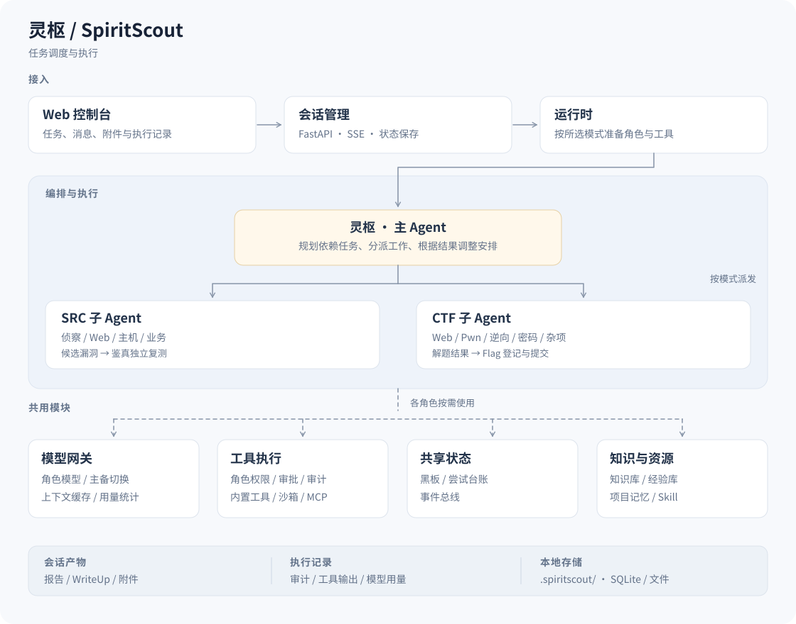

<div align="center">

# 灵枢 · SpiritScout

**多智能体安全测试工作台**

在网页上下达任务，主 Agent 拆计划，子 Agent 并行执行，
过程、证据和产物都留在同一个会话里。

**简体中文 · [English](README_EN.md)**

[](CHANGELOG.md) [](pyproject.toml) [](https://github.com/FLIAZ/SpiritScout/actions/workflows/ci.yml) [](LICENSE)

[快速开始](#快速开始) · [三种模式](#三种模式) · [界面](#界面) · [工作原理](#工作原理) · [配置参考](#配置参考) · [常见问题](#常见问题) · [部署指南](docs/部署与配置.md)

</div>

> 仅用于已获授权的测试目标与赛事。任务范围的界定方式、审批策略与数据落点见 [数据与使用边界](#数据与使用边界) 与 [安全策略](SECURITY.md)。

## 它是什么

一个跑在本机或自建服务器上的安全测试工作台。你在网页上把任务说清楚——目标、规则、附件、模式——灵枢（主 Agent）把它拆成一张有依赖关系的任务图，交给专项子 Agent 并行推进，你在同一个页面里看进度、介入指导、验收产物。

它和"一个聊天框加一堆工具"的区别在四件事：

| | 意味着什么 |
| --- | --- |
| **有计划** | 任务是一张 DAG，不是一条消息接一条消息。哪条路线卡住、哪道题还没开始，图上看得见 |
| **有分工** | Web / Pwn / 逆向 / 密码 / Misc 各有子 Agent，各自带工具与知识，共享同一块黑板交换事实 |
| **有出处** | 每个结论都能追到具体那次工具调用和它的原始输出；拓扑区分真实产出与上下文延续 |
| **有人管** | SRC 的危险操作逐次问你；CTF 与竞赛预授权但全程留审计 |

模型不绑定：供应商、模型 ID、每个角色的指派都在控制台里配，改完即生效。
解题模板不写死在代码里——知识库存的是参考事实（平台特性、载荷、常见坑），步骤序列由模型结合现场决定。

## 三种模式

| 模式 | 典型场景 | 危险操作 | 无人值守 | 会向你提问 |
| --- | --- | --- | --- | --- |
| **SRC** | 授权资产分析、漏洞复测、渗透报告 | 删除文件、反弹 shell、上传 WebShell、容器逃逸、爆破等逐次审批 | 否 | 会：范围不清、缺信息时问 |
| **CTF** | Web、Pwn、逆向、密码、Misc 解题 | 预授权，全程留审计 | 可 | 会：任务缺关键信息时问 |
| **智能体竞赛** | 平台托管、多题调度、完成回收 | 预授权，全程留审计 | 是 | 不会；也不使用公开网页搜索 |

模式由**你在前端选择**，后端不改判；选过之后记在本机，下次默认还是它。
项目里的历史资产不会自动变成本次测试的授权目标。

## 界面

控制台是一个单页应用。左侧只放六项主功能（任务、仪表盘、用量、编队、项目、经验），其余收进「设置」：

| 视图 | 用来做什么 |
| --- | --- |
| **任务** | 选模式，填目标、规则、附件，下发任务；看当前会话卡片 |
| **仪表盘** | 跨会话的调用量、Token、费用估算、异常告警（模型等待过久、有空闲名额却没派活等） |
| **用量** | 按模型统计 token：调用次数、输入/输出、缓存读、占比与费用（近 1 小时 / 今天 / 7 天 / 30 天 / 全部） |
| **编队** | 给灵枢和各子 Agent 分配模型与提示词 |
| **项目** | 把资产和会话归到一起；候选漏洞由「鉴真」独立复测 |
| **经验** | 沉淀下来的、可复用的判断与踩坑记录；入库前先查相似（默认 ≥95% 视为重复，不重复存）。存量条目两种整理方式：**二次提炼**（极相似→压成一条，确认后退回原件，相似度默认 90% 可改）与**合并**（交给 AI 判断能不能并进已有经验，只更新目标、不删任何条目）；勾选不限条数，全选覆盖整库 |

会话详情不进导航，从任务列表点进去就是。会话页的状态标签里还有一个**模型下拉**：只给这一个会话指定首选模型（空 = 跟随「模型」页的优先级链），运行中改也立即生效。

任务下发后就一直在跑，不因为你切了视图而停。**所以切走的时候左下角会浮出一条「N 个任务在后台运行」**——点开能看见每条的标题和状态（排队中 / 运行中），点一行直接切回去；全部收尾后坞自己消失。只报状态不报进度条：别的会话跑到第几步前端并不知道，与其画个假的，不如点进去看真的。

点侧栏底部的「设置」打开独立设置界面：左侧一列分类，右侧对应内容，不是弹窗；和主界面来回切不丢状态，入口还会记着上次看的那一页。

| 设置分类 | 用来做什么 |
| --- | --- |
| **模型** | 供应商地址、API Key、模型 ID、连通性测试、启用 / 停用 |
| **MCP 接入** | MCP 服务器配置、管理对话、Exa 检索 |
| **Skill 知识** | 技能包与参考知识 |
| **通知** | 解出题、灵枢等你拍板时弹系统通知；开关、权限、已读都在这页 |
| **关于** | 版本、主题切换、退出登录、一键清理无用缓存 |

跑在后台的任务最怕「解出来了没人告诉你」。**解出一道题（平台判定正确），或者灵枢卡在需要你回答的问题上，控制台会弹一条系统通知**——切到别的窗口也收得到，点一下直接跳回那个会话。浏览器没给通知权限时退化成页面内提示加标签页标题计数，不会静默跳过；正看着那个会话、屏幕上已经有提问卡时不再重复弹；一轮积压太多只弹前三条，其余折成一条「另有 N 条提醒」，剩下的去「设置 → 通知」的「最近提醒」里看。拉取的节奏跟着控制台原有的轮询（可见 15 秒、隐藏 30 秒），不另开定时器，也不在服务端记「已读」——多开几个标签页，各看各的屏。

会话内的页签：**会话** · **拓扑** · **题目列表** · **漏洞** · **Flag** · **经验** · **事件** · **记录与文件** · **WP** · **报告**。
「题目列表」只在智能体竞赛模式出现；「WP」（解题思路）在 CTF 模式下可生成，别的模式只要本场跑完自动写过 WP 也会出现（那种只给看和下载，不能重新生成）——生成前先确认团队信息与题目分章，可以留空，填过的会记住。

## 能力

| 能力 | 可以做什么 |
| --- | --- |
| 编队协作 | 主 Agent 拆分任务，子 Agent 派生路线、共享线索，按角色分配模型 |
| 执行工作台 | 展开任务、路线与推进步骤，查看工具结果及带审计出处的过程拓扑；每个子 Agent 标出当前用的模型与渠道（打开旧会话也照样显示） |
| 项目与产物 | 保存资产和会话；候选漏洞独立复测；生成报告或解题思路 |
| 解题思路（WP） | 按赛方模板成文，**只讲解题过程**：生成前确认团队信息与题目分章（可留空、下次带出），按方向分章、逐题写清看到什么现象、怎么判断、打了什么、最后拿到什么 Flag，命令与脚本贴原文；不写验证环节（判定/提交回执）、不写经验复盘、不写内部编排；可下载 Markdown |
| 浏览器与工具 | 接入 MCP、Skill 与 shell/Python 沙箱；SRC 可复用登录态并人工处理验证码 |
| 本地模型 | 把本机推理端点（LM Studio / Ollama）接成 MCP 工具：看状态、列模型、单轮提问；不出网不计费，适合摘要改写这类廉价活 |
| 本地工具索引 | 在「设置 → 本地工具」里添加几个工具目录，Agent 就能按名字检索本机现成的 exe / 脚本并运行；运行时先把工具目录复制到工作区暂存副本、隔离临时目录与 HOME，跑完对账（新增删掉、改动还原）、核对清单一致后销毁副本——**用完不留残留文件**，超上限或还原不了就拒跑 |
| 模型与用量 | 配置供应商、编队与模型，查看费用估算、Token、端点返回的输入缓存用量 |
| 经验沉淀 | 把验证过的判断写回经验库，后续同类任务可直接取用 |

----

历史跑分记录 · tsecbench（2026-10-23）

原记录使用 DeepSeek v4.1 Flash，供参考


## 快速开始

### Docker（推荐）

需要 **Linux 容器模式**和 **Docker Compose 2.20+**。Windows 用 Docker Desktop，Linux 用 Docker Engine；macOS / ARM64 的兼容待开发。

```bash
git clone https://github.com/FLIAZ/SpiritScout.git
cd SpiritScout
python deploy.py up
```

Windows 用 `py -3 deploy.py up`，Linux / macOS 用 `python3 deploy.py up`。
首次运行会创建 `.env`、生成随机管理员密码、构建镜像并等待服务健康。

| 入口 | 地址 |
| --- | --- |
| **控制台** | <http://127.0.0.1:10010>　用户名与密码见项目 `.env` |
| **SRC 浏览器** | `python deploy.py up --browser` 后访问 <http://127.0.0.1:10011>，凭据与控制台一致 |

| 命令 | 作用 |
| --- | --- |
| `python deploy.py status` | 看容器状态 |
| `python deploy.py logs` | 跟踪日志 |
| `python deploy.py down` | 停服，保留数据卷 |
| `python deploy.py doctor` | 自检部署环境 |
| `python deploy.py migrate` | 旧版挂载部署迁移到数据卷 |
| `python deploy.py up --no-build` | 用已构建镜像重启，不重新构建 |
| `python deploy.py up --project-name other` | 隔离另一套并行的容器、卷与网络 |

镜像自带 Chromium 与 bubblewrap。CTF 工具箱按需在 `.env` 设 `INSTALL_TOOLKIT=1` 后重建镜像。
默认使用镜像内源码与独立数据卷；从旧版挂载部署升级前先停服迁移，不要直接删数据卷。

<details>
<summary>改用 Docker Compose 手动部署</summary>

复制 `.env.example` 为 `.env`，设置管理员用户名和强密码，再启动：

```bash
docker compose up -d --build --wait
```

源码开发覆盖、管理员恢复、反向代理、数据迁移与备份见 [部署与配置](docs/部署与配置.md)。

</details>

### Linux / Windows 本地运行

<details>
<summary>展开本地安装步骤</summary>

需要 Python 3.11+。原生浏览器工具另需 Node.js 22+ 和 Chromium/Chrome，也可用 `SPIRITSCOUT_CHROME_EXECUTABLE` 指定路径。

装依赖国内建议加镜像：`-i https://pypi.tuna.tsinghua.edu.cn/simple`（清华 TUNA，也可以用
`https://mirrors.aliyun.com/pypi/simple/`）。仓库根那套 `start-local.ps1` 已经把镜像当默认
——它自检到缺依赖就会用镜像装，镜像不可用时自动退官方源重试。

**Linux**

```bash
python3 -m venv .venv
.venv/bin/python -m pip install -e . -i https://pypi.tuna.tsinghua.edu.cn/simple
sudo apt install bubblewrap   # Debian / Ubuntu；Fedora 用 sudo dnf install bubblewrap
./launch.sh
```

**Windows（cmd）**

```bat
py -3 -m venv .venv
.venv\Scripts\python.exe -m pip install -e . -i https://pypi.tuna.tsinghua.edu.cn/simple
launch.cmd
```

访问 <http://127.0.0.1:8000>，`Ctrl+C` 停止。改端口：`./launch.sh --port 10010` 或 `launch.cmd --port 10010`。

**Windows 桌面版（带自己的窗口）**

不想开黑窗口、也不想在浏览器标签页里跑控制台，用桌面版：`launcher/SpiritScoutDesktop.cs`
编译成一个约 824 KB 的 exe，WinForms 窗口 + 内嵌 WebView2，关窗口即停服务。

```powershell
powershell -ExecutionPolicy Bypass -File launcher\build-desktop.ps1
```

首次会下 WebView2 SDK（约 8 MB，缓存到 `launcher/.cache/`，之后加 `-SkipDownload` 可离线）。
用 Windows 自带的 `csc.exe` 编译，**不需要 .NET SDK**；三个 WebView2 DLL 作为资源编进 exe，
首次运行时解到 `%LOCALAPPDATA%\SpiritScout\lib`（写不进去退程序目录、再退临时目录）。
窗口里能做四件事：环境自检 / 一键修复（调 `scripts/bootstrap.py`）、启动与停止服务（端口被占
自动换下一个）、内嵌页面、看日志（同时写 `logs\desktop-<日期>.log`）。没有 WebView2 运行时
时自动退到 Edge 的 `--app=` 独立窗口。

命令行排障用同一个脚本，不必开窗口：

```powershell
python scripts/bootstrap.py            # 体检：解释器、venv、缺哪些依赖、可用端口
python scripts/bootstrap.py --fix      # 一键补齐（清华 → 阿里 → 官方逐源重试）
python scripts/bootstrap.py --json     # 给脚本/GUI 消费
```

**默认没有登录**：控制台直接进（`web.auth_mode: none`）。`launch.cmd` / `launch.sh`
不会逼你设密码（它们不碰管理员账号），库里以前留下的账号也不会把界面重新锁上；
仓库根那套本机启动器（`启动服务.cmd` → `start-local.ps1`）首次启动会问一次，回车两次
跳过即可，不设也能直接进。想开登录：

```bat
.venv\Scripts\python.exe -m spiritscout --set-admin-password
launch.cmd --auth password
```

想彻底清掉凭据：`.venv\Scripts\python.exe -m spiritscout --clear-admin-password`。
设密时**密码长度不设限制**，一位和整句话都收；在终端里设完会把明文**当场显示一次**
方便记下来，之后重启、日志、界面都不再显示，库里始终只有 scrypt 哈希
（自动化用 `--password-stdin` 喂密码，这条路不回显；空密码等于不设密码）。
监听非回环地址（`0.0.0.0`）时默认仍要求先启用登录，除非显式把
`web.remote_auth_required` 设为 false。

终端窗口会先打出绑定地址，**等端口真能连上再说一句 `[就绪] 浏览器可以打开了`**——
首次启动要建库、预热模型，等多久说不准，所以不拿固定秒数猜。之后每 60 秒报一行
`[状态] 已运行 01:00 · 会话 2（运行中 0） · 内存 244 MB`，不开任务管理器也能知道它活着。

```
灵枢 Web 控制台 v0.47.3: http://127.0.0.1:8010  (登录已关闭，本机直接进入（auth_mode=none），并发上限 4，Ctrl+C 停止)

[就绪] 浏览器可以打开了: http://127.0.0.1:8010
       每 60 秒报一次状态；Ctrl+C 停止

[状态] 已运行 01:00 · 会话 2（运行中 0） · 内存 244 MB
```

shell / Python 沙箱需要 Linux + bubblewrap；Windows 与 macOS 原生控制台降级为 host 后端，
拿不到这一整套隔离，需要完整工具链时请用 Docker。三者的虚拟环境不要混用。

</details>

### 跑通第一个任务

1. **配模型**：进「模型」页，填供应商地址、API Key 与模型 ID，点连通性测试。
   用不上的模型点「停用」即可退出选用，配置留着，想用再点回来。
2. **分角色**：进「编队」页，给灵枢和各子 Agent 指派模型（可以都指同一个）。
3. **下任务**：回首页选模式，填目标 / 题目、规则与附件，点「开始执行」。
4. **看现场**：进会话页，「会话」页签看每一步，「拓扑」页签看推进结构，需要时在对话里补充信息。
5. **收产物**：「记录与文件」页签取交付物，「报告」与「WP」页签取成文，Markdown 可直接下载。

再进一步是**单文件版**：同一个 exe，尾部挂着运行时 zip，拷到机器上双击就开，连解压都省了。

```powershell
powershell -ExecutionPolicy Bypass -File SpiritScout\launcher\build-portable.ps1   # 先有便携目录
powershell -ExecutionPolicy Bypass -File SpiritScout\launcher\build-single.ps1     # 拼成一个 exe（约 132 MB）
```

首次启动花十几秒把运行时解到 `%LOCALAPPDATA%\SpiritScout\runtime\<长度-指纹>`（不可写就退到
exe 旁边、再退到 `%TEMP%`），之后启动只要一两秒。三种形态（单文件 / 便携 / 仓库）是同一个 exe，
按「有没有尾标载荷」「旁边有没有 desktop.json」自动选。


### 便携版：目标机器什么都不用装

上面那个 exe 只是壳子，还是要目标机器上有 Python。要交到一台干净机器（或者塞 U 盘）上，
就打便携版：内嵌 Python 3.11 运行时 + 装好的依赖 + exe 摆进同一个目录，解压双击就开。

```powershell
python -m build --outdir dist SpiritScout          # 便携版装的是 wheel
powershell -ExecutionPolicy Bypass -File SpiritScout\launcher\build-portable.ps1
```

产物 `dist-portable\灵枢便携版-<版本>\`（约 334 MB；zip 约 150 MB）里 `desktop.json` 告诉 exe
用 `py\python.exe` 那个内嵌解释器，`configs\` 只放模板（`*.example.yaml` 改出来的），
第一次用先填 `models.yaml`。这个目录是整个 release 里唯一的「完全免安装」形态——
wheel 要 pip、zip 要 Python、exe 要仓库。


### 发行包（Release 附件）

不想拉源码自己装，就直接下打包好的。三个包都带**做题经验**，但技能库不一样，
按需要挑；Windows 用户还可以直接拿桌面版 exe：

| 附件 | 带什么 |
| --- | --- |
| `spiritscout-0.47.3-py3-none-any.whl` | `pip install` 用：前端静态页面、知识库种子、报告模板、206 条内置安全技能（`knowledge/data/security_skills.json`）、342 条经验（`knowledge/data/experience.json` + `experience.md`）。**不含** `skills/` 那套自定义技能包（它有 5669 个文件，塞进 wheel 太重） |
| `spiritscout-0.47.3.tar.gz` | sdist（约 24 MB）：整份源码 + `skills/` 技能包的文本素材（4549 个文件，插图与演示视频留在 zip 里）+ 配置模板（`skills.yaml`、`models.example.yaml`、`models.mock.yaml`、`system.example.yaml`）+ 经验。真实 `models.yaml` / `system.yaml` 不在里面 |
| `spiritscout-0.47.3.zip` | 整仓源码：代码、`skills/`、`configs/`、`experience-export/`、`EXPERIENCE.md`，解开就按上面「快速开始」跑 |
| `spiritscout-desktop-0.47.3-win64.exe` | **Windows 桌面版**（约 824 KB）：自带窗口的客户端，内嵌 WebView2，不是浏览器标签页。里面已包含运行所需的 WebView2 托管 DLL 与原生 loader（首次运行自动解到 `%LOCALAPPDATA%`），双击即用；**仍需要本机有 Python 3.11+ 与一份仓库源码**——它负责起停服务与环境自检，不代替解释器 |
| `SHA256SUMS` | 上面几个包的校验和，装前先对一遍 |

```bash
pip install spiritscout-0.47.3-py3-none-any.whl
spiritscout --help
```

pip 装完只有内置技能，想补上仓库那套自定义技能包：

```bash
python -m spiritscout.resources.skill_sync import skills   # 从解开的 zip / sdist 里导
```

**怎么出的包**：推一个 `v*` tag，仓库根 `.github/workflows/package.yml` 会自动
核对 tag 与 `__version__` 是否一致（不一致直接失败）、用
`python -m spiritscout.knowledge.digest` 现算一份经验摘要、`python -m build` 出
wheel 与 sdist、`git archive` 打整仓 zip 并把摘要塞进去、再装进干净 venv 验证
`web/static/js/count.js` 和 `knowledge/data/experience.json` 真在包里。桌面版 exe
在另一个 Windows 任务里用系统自带 `csc.exe` 编（不需要 .NET SDK），两边产物汇到
最后一并算 `SHA256SUMS` 再附到同名 Release。没打 tag 也能出包：Actions 页面选
「打包并发布」→ Run workflow，填一个已存在的 tag 即可。

删了重传同名附件后，下载链接可能还被 CDN 缓存几分钟（表现是校验和对不上），
加个 ?cb=<随机> 再取一次才是新文件。

> 打包只带 git 跟踪的文件加现算的摘要：`.venv/`、`.spiritscout/` 工作区数据、
> `configs/models.yaml` 里的真实密钥都不会进包；经验在导出时已脱敏（地址、IP、
> flag、密钥都换成标记）。

## 工作原理



```
用户任务 ──► 灵枢（主 Agent）
               │  规划：任务 DAG（题目 / 目标 → 可并行路线）
               ├──► 子 Agent 集群（Web / Pwn / 逆向 / 密码 / Misc …）
               │        └── 工具层：浏览器、shell/Python 沙箱、MCP、Skill
               │        └── 共享：黑板（事实）、尝试台账（防重复踩坑）
               └──► 汇总：Flag 判定、漏洞鉴真、报告 / 解题思路
```

- **规划在执行中调整**：主 Agent 看得到子 Agent 的进展与失败，会重排任务图，不是一次性计划。
- **事实集中在黑板**：线索、发现、拓扑写进同一处，子 Agent 之间不靠层层转述。
- **尝试台账防重复**：同一路线失败多次会被记录下来，换方法而不是反复撞同一堵墙。
- **Flag 由模型判定**：后端不做正则提取；提交结果与判定依据都留档。
- **模型网关统一处理**：供应商协议、流式输出、用量与缓存命中都在网关层收口。
- **工具层管权限**：按模式决定审批、沙箱与审计；步骤、观察、发现和产物都保留原始出处。

模块划分与关键函数索引见 [架构总览](docs/02-架构总览与项目结构.md) 与 [代码地图](docs/10-代码地图与关键函数索引.md)。

## 配置参考

### 配置文件

| 文件 | 内容 |
| --- | --- |
| `configs/system.yaml` | 系统配置：Web 监听、沙箱后端、事件总线、路径等（示例见 `system.example.yaml`） |
| `configs/models.yaml` | 供应商与模型清单（示例见 `models.example.yaml`） |
| `.env` | Docker 部署用的管理员凭据、镜像与可选工具箱开关 |

控制台里改的模型配置会覆盖启动时的快照，不需要重启。

### 环境变量

| 变量 | 作用 |
| --- | --- |
| `SPIRITSCOUT_ADMIN_USERNAME` / `SPIRITSCOUT_ADMIN_PASSWORD` | 管理员凭据，启动时导入管理员库（优先级最高，会覆盖本机设的密码并打一条 WARNING；不设就用首次启动设的那份） |
| `SPIRITSCOUT_SERVER_PASSWORD` | 旧版管理密码，仍兼容；用户名默认 `spiritscout` |
| `SPIRITSCOUT_VAULT_KEY` | 凭据库主密钥；不给则首次启动生成 `vault.key`（权限 0600） |
| `SPIRITSCOUT_REMOTE_LLM_KEY` | 远程模型 Key 的兜底来源 |
| `SPIRITSCOUT_SANDBOX_BACKEND` | `auto`（默认）/ `bwrap` / `host`。auto 有 bwrap 就用，Windows/macOS 退 host |
| `SPIRITSCOUT_HOST_BASH` | host 后端使用的 shell 路径（Windows 装 Git Bash 时用） |
| `SPIRITSCOUT_CHROME_EXECUTABLE` | 指定 Chromium/Chrome 可执行文件 |
| `SPIRITSCOUT_CHROME_CDP_URL` | 连接已有浏览器的 CDP 地址 |
| `SPIRITSCOUT_CHROME_MODE` | `cdp`（默认）或 `headless` |
| `SPIRITSCOUT_BROWSER_TMP_PRUNE_MB` | 浏览器临时档案的清理阈值，默认 64；写 `0` 表示每次退出都清 |
| `SPIRITSCOUT_BUS__BACKEND` | 事件总线后端，如 `redis` |
| `SPIRITSCOUT_REDIS_URL` | Redis 连接串 |

任意配置项都能用 `SPIRITSCOUT_<段>__<字段>` 覆盖，例如
`SPIRITSCOUT_WEB__PORT=10010` 等价于改 `system.yaml` 里的 `web.port`。

### 数据落在哪里

原生运行在 `.spiritscout/`；Docker 落在配置卷、数据卷和可选的浏览器档案卷。

| 路径 | 内容 |
| --- | --- |
| `sessions/` | 每个会话的工作区：黑板、审计、Flag、报告、解题思路、截图 |
| `resources/` | 知识库与资源库 |
| `admin.db` / `auth.key` | 管理员（scrypt 哈希）与登录 Cookie 的签名密钥 |
| `vault.db` / `vault.key` | 加密后的供应商 Key 与主密钥 |
| `usage.db` | 调用量与 Token 计量 |
| `experience.db` | 经验库 |
| `audit.jsonl` | 全局审计流水 |
| `preferences.json` | 界面偏好（当前就是上次选的模式） |
| `wp-profile.json` | 解题思路用的团队信息（创建后出现） |

备份时把 `.spiritscout/` 整个目录和 `.env` 一起带走；只备份数据库不备份 `vault.key`，恢复后 Key 解不开。

### 做题经验包含什么

灵枢的「经验」分两层，都是可读可改的本地文件，不埋在模型权重里。

**一、知识库：参考事实（静态，随代码分发）**

| 文件 | 内容 |
| --- | --- |
| `src/spiritscout/knowledge/data/security_skills.json` | 各方向手法索引（约 645 KB）：Web / Pwn / Reverse / Crypto / Misc / 取证等，按「怎么做」组织 |
| `src/spiritscout/knowledge/seed.py` | 结构化种子知识：平台特性、载荷形态、常见坑位 |

按项目约定，这里**只存参考事实，不存步骤序列**——解题步骤由模型结合现场决定，不写死在代码里。

**二、经验库：实战判断（动态，越用越厚）**

`experience.db` 的 `insights` 表，每条是一句洞察加它的适用条件：

| 字段 | 含义 |
| --- | --- |
| `insight` | 一句话洞察，通常是判读规则而非操作步骤 |
| `context` | 适用场景（写清边界，避免乱套） |
| `tags` | 标签，检索与召回用 |
| `source_session` / `source_model` | 来源会话与提炼它的模型 |
| `merged_into` / `merged_from` | 二次提炼的溯源：结果记着吸收了哪些条目；`merged_into` 只留给旧数据（新口径确认保留后原件已删除） |
| `ts` | 时间戳 |

预置的那批都是「怎么判读」类：云靶场实例回收后坐标不再指向同一环境；连接超时在按需实例上该先当成实例生命周期信号，而不是目标防护；零轮次战报不能当作难度或防护强度的证据；赛事入口令牌过期与靶场下线难以区分；赛事接入层与题目实例层的可达性互不蕴含，探测失败不能外推。

**它怎么长**

任务收尾时模型提炼本次实战的洞察写回；**每解出一道题（Flag 落地的那一刻）也会立刻提炼一次**——材料只围绕刚解出的那道题（题面、这道题的路线与关键判断、Flag 形态），后台排队跑，不打断后续解题。同一道题的多枚 Flag 只提炼一次，避免重复条目。下个任务开工时按 `experience.recall_limit`（默认 6）召回注入上下文。所以同一个环境打得越多，判读越贴合。

每个会话页的「**经验**」页签是它的落地窗口：左边是这次产出的条目（标签、适用场景、来源模型与时间），右边是这次会话的提炼记录（解出即提炼、收尾提炼、手动补提炼，成功还是失败、失败原因）。解出即提炼与收尾提炼都走后台队列，失败会重试、进程中断会在下次启动补跑。自动提炼因为模型不可用或会话被中断而跳过时，页面上的「手动提炼」可以补一次——战报按落盘状态重建，停掉的会话也能补；会话还在跑、或者确实没有活动时按钮会给原因，不白烧一次模型调用。

想归零删 `experience.db`（下次启动重建空库）；想带走连 `.spiritscout/` 一起拷。知识库那两个文件删了会丢内置参考，别动。

**它不会因为删会话而变薄**

经验库是共享的，删会话只清会话工作区目录，库里的条目一条不少。老版本曾把条目写进会话目录里的 `experience.db`，所以删会话前会先把那份并回共享库再删目录；来源会话不在了，条目照样按原文展示（只是不再提供跳转回链）。

**入库判重：重复的不进库**

提炼（自动、手动都一样）把一条洞察写进库之前，先比一遍库里最近两千条**有效**经验：完全同文直接取消，相似度达到 `experience.duplicate_threshold`（默认 **95%**，去空白标点后的编辑相似度）也取消——只留一条 `experience.near_duplicate` 审计，记着它像哪一条、差多少。被二次提炼合并掉（原件已删）的条目不参与比较，所以同类的**新**经验不会被历史包袱挡住。想让同义句也进来就把阈值调到 `1.0`（只挡完全同文）。

会话页「经验」页签会如实交代结果：`提炼完成，新增 1 条经验，跳过 2 条与库里高度重复的`；全是重复时结论是「与库里重复」而不是「失败」，也不算新增。

**一本账：自动提炼、手动提炼、经验页、开工召回读的是同一个文件**

落点统一由 `shared_db_path(cfg)` 给出（`experience.root`，空则跟随工作区根目录），**不按会话目录算**——老版本自动提炼曾写进 `sessions/<id>/experience.db`，结果「提炼成功但库里没有」。升级后启动时会先把这些散落的会话库并回共享库（幂等），旧的提炼成果不会丢。

**二次提炼：先提炼，确认保留才删原件**

「经验」页右上角的「二次提炼」会列出**整组两两相似度都 ≥ 90%** 的条目（归一化后的编辑相似度，中文同义改写也认得出来）。这个相似度**可以自己改**：面板顶部一个百分比输入框（50%–100%，默认 90%），改完点「重新查询」，下次打开还记得上次的值；调低能捞到更多候选，调高只留几乎一模一样的。

每一步都留给你确认：勾选条目（「全选」勾的是**整库**可提炼条目——页面会先按每页 200 条把库拉全再勾，不受列表分页影响，也没有「一次最多 20 条」的上限；也可以按组点「提炼这 N 条」）→ 点「提炼」只算出**提炼稿**，页面标着「提炼结果（还没入库）」，此刻库里的东西一个字都没动 → 点「保留并删除 N 条原件」才真正落库：结果写成一条新经验，被提炼的那几条在同一事务里删除，删除的 id 全部记进审计（`experience.merged`）；点「放弃」就什么都不动。提炼是确定性的：取信息量最大的那条当底稿，其余条目里底稿没有的句子按「另：…」并入，**不调模型改写**，所以差异细节不会被润色掉。服务端每次都会按当前阈值再复检一次，不够相似直接拒绝并说明最低相似度。

被删的原件不会出现在任何列表里（`include_merged` 也找不回），但它们的信息已经在提炼稿里，溯源记在结果的 `merged_from` 上（卡片标「二次提炼 · N 条」）。老版本留下的「只标记不删除」的条目仍可查：点「显示已合并」看灰掉的原文，点「还原」解封原件、移除派生的合并条目。

**合并：交给 AI，但一条都不删**

「二次提炼」右边还有一个「合并」。它走的是另一条路：把你勾选的条目和库里其它经验一起交给模型，让模型判断**这些内容该并进已有的哪一条**。相同规律不必占两行，但也不需要冒删错的风险：

- 只更新目标那一条的正文、适用场景和标签（标签取并集，只增不减），被勾选的条目**原样留在库里**；
- 模型只能选本次候选集里的 id（库里其它有效条目），候选集里没有的、或模型自己编的 id 一律整组作废；
- 模型说没有可并入的就什么都不写，页面照实写「没有可以并入同一条经验的内容」——不动库也是合格答案；
- 落库前后各数一次条目总数，少一行就整体回滚并报错（写死的硬约束：这条功能不存在删除分支）；
- 溯源记在目标条目的 `absorbed_from` 上（多次合并会累积），参考时能看到这段文字是吸收谁来的。

两个按钮互斥（同时只开一个面板），勾选状态共用，所以「先看候选、再决定用哪种整理方式」的操作是连贯的。

**跨机器共享：提交 / 拉取**

经验库本身是本地 SQLite，不跟着仓库走。「经验」页右上角另有两个按钮，靠仓库里的一份文本清单同步：

- **提交**：把本地经验导出成 `experience-export/inbox/<提交人>-<时间戳>.json`，提交并推送。**每人一个文件**，不改公共主清单——所以谁都能提，不用先拉最新，也不会覆盖别人的提交（没有推送权限时 fork 后推自己的分支再提单即可）。
- **拉取**：`git fetch` 之后把主清单 `experience-insights.json` 与 `inbox/` 下所有人的文件一起读，按**内容指纹**（去标点空白后的 sha1）只补本地缺的条目——本地已有的原样保留，不覆盖、不删除。

清单里每条只带 `insight / context / tags / source_model / ts` 与溯源字段，不含会话正文、审计原文或凭据；导出前统一脱敏（URL、`IP:端口`、密钥、flag 字面量），并跳过老口径「已合并」的隐藏原件。两种格式都认：本功能的 `spiritscout.experience/v1` 与目录里既有的 `spiritscout-experience-insights` 快照。

### 命令行

```bash
spiritscout --version            # 版本
spiritscout --host 0.0.0.0 --port 8000
spiritscout --config path/to/system.yaml
```

## 常见问题

**模型连通性显示正常，任务却立刻失败？**
连通性测试只要求模型回一句 `ok`，不覆盖完整的流式工具请求。项目固定了兼容的 LiteLLM / MCP 版本，
更新依赖后重新构建镜像，不要单独升级 LiteLLM。排查见 [模型调用与依赖兼容](docs/部署与配置.md#模型调用与依赖兼容)。

**Windows 上任务跑不起来？**
shell / Python 沙箱依赖 Linux 与 bubblewrap。Windows 原生控制台会自动降级到 host 后端，工具能力受限。
需要完整能力请用 Docker Desktop；或装 Git Bash 并用 `SPIRITSCOUT_HOST_BASH` 指定。

**端口被占用？**
Docker 部署改 `.env` 里的端口映射；本地运行用 `--port`。换端口后记得用新地址访问。

**想换成别的模型？**
「模型」页新增供应商与模型 ID，然后去「编队」页把角色重新指派。不需要改配置文件或重启。

**想让某个模型排前面？**
「模型」页的优先级链就是路由顺序：链上第一条是首选，取不到才往下走，没列进链的排在最后。运行中的会话按 `gateway.priority_refresh_seconds`（默认 30 秒）重读这份顺序，改完下一批调用就跟上，不重启也不重开会话；想给某个角色钉死一个模型，就在「编队」页指派。

**这个会话能不能单独用某个模型？**
能。会话页的状态标签里有个模型下拉：选完只有这一个会话改用它（灵枢车道 + 没在编队页指派的子 Agent），下一批调用立刻生效，运行中改也认；选「自动 · 跟随全局优先级」就回到上面的优先级链。取舍只有一条：**编队页给具体子 Agent 的指派仍然优先**——那是你逐角色的定点配置，不该被一个会话的选择盖掉。选的模型后来被停用/删除时，会话自动退回优先级链，不会因此卡死。

**解题思路里团队信息是空的？**
信息页可以完全留空——留空处写「（待填写）」，不影响生成。填过一次后会自动带出；
清空再生成等于忘掉。题目分章不落盘：换了题目 id 就重新按题面自动判定。

**会话跑到一半卡住了？**
先看仪表盘告警——模型调用等待过久、有空闲名额却没派活都会单独报出来。
再进会话的「会话」页签看最后一条工具结果；需要时直接在对话里给方向。

**数据怎么迁移？**
Docker 用 `python deploy.py migrate`；手工迁移时停服 → 拷 `.spiritscout/`（或数据卷）→ 在新环境启动。
跨机器迁移要保留 `vault.key` 与 `admin.db`，否则凭据与登录态都失效。

## 数据与使用边界

- **授权范围**：由模型结合你的原话、项目规则和后续答复在上下文中维护；后端不写死禁打清单，扩围会来问你。
- **审批策略**：SRC 危险操作逐次审批；CTF 与智能体竞赛预授权并留审计。沙箱是加固，不是目标范围的确定性阻断。
- **凭据**：API Key 加密存在工作区。不要公开真实 Cookie、HAR 或审计原文。
- **调用成本**：模型与付费搜索的费用由所接入服务收取；仪表盘是估算值，实际以供应商账单为准。
- **缓存与基线**：缓存命中量取自端点返回值；失败、取消、未知用量分别记录。对照方法见 [缓存优化与测试](docs/05-核心算法与技术实现.md#稳定前缀与测试修复0122)。

## 文档与贡献

当前代码版本 **v0.47.3**。版本唯一来源、递增规则与历史说明见 [版本管理](CONTRIBUTING.md#版本管理)。

| 我想了解 | 阅读入口 |
| --- | --- |
| 安装、模型、浏览器、迁移与备份 | [部署与配置](docs/部署与配置.md) |
| 架构、执行流程和代码位置 | [项目文档索引](docs/README.md) |
| 核心算法与技术实现 | [核心算法与技术实现](docs/05-核心算法与技术实现.md) |
| 修复问题或提交新功能 | [贡献指南](CONTRIBUTING.md) · [Agent 工作约定](AGENTS.md) |
| 版本变化与兼容修复 | [更新日志](CHANGELOG.md) |
| 私密报告项目自身漏洞 | [安全策略](SECURITY.md) |

## 许可与使用约定

项目代码采用 [Apache License 2.0](LICENSE)。引用的知识库、Skill 和外部工具遵循各自的许可证。

<details>
<summary>法律免责声明与使用合规须知</summary>

### 1. 工具定位

本项目（以下简称「本工具」）为网络安全学术研究、授权安全测试、企业内部风险自查用途的开源技术工具。

本工具所有功能仅面向拥有合法授权的测试场景，旨在提升网络安全防御能力、助力漏洞合规治理、推进安全技术学术研究。

### 2. 严格授权使用原则

所有使用者必须提前获得目标系统的书面合法授权。

严禁在无授权、越权、超范围情况下，对以下对象进行扫描、探测、渗透、数据获取、流量分析、自动化测试：

- 互联网公网任意未授权系统
- 金融、能源、政务、运营商、交通等关键信息基础设施
- 第三方企业、个人、公有云任意业务系统
- 任何法律法规禁止测试的信息系统

未授权测试即属于违法行为，使用者自行承担全部法律责任。

### 3. 禁止滥用条款

所有使用者承诺：

1. 不得利用本工具实施非法入侵、非法控制、数据窃取、流量攻击、漏洞滥用等违法犯罪行为；
2. 不得将本工具用于黑产、牟利、恶意破坏、未授权批量扫描、网络骚扰等场景；
3. 不得绕过、破解本工具内置的安全限制、黑白名单风控机制用于非法用途；
4. 不得用于危害国家网络安全、扰乱公共秩序、侵犯他人合法权益的活动。

### 4. 责任边界（核心免责）

1. 项目开源作者、维护团队、贡献者：仅提供公开的技术代码与学术实现，不参与、不知情、不协助任何第三方的非法使用行为，不对第三方滥用产生的任何后果承担刑事、行政、民事连带责任。
2. 本工具技术中立，合法合规用途明确，任何使用者的违法操作均为独立个人行为，与项目作者无关。

### 5. 强制合规义务

使用者使用本工具即默认表示：

- 已充分知晓《中华人民共和国网络安全法》
- 已充分知晓《中华人民共和国刑法》第285条、第286条相关规定
- 已具备合法网络安全测试资质或授权资质
- 自愿承担所有使用风险及法律后果

### 6. 违规处置机制

项目团队保留以下权利：

- 随时关停仓库、终止分发、更新风控限制
- 举报、记录、留存恶意滥用行为证据
- 拒绝为非法使用者提供任何技术答疑、指导、更新、协助

### 7. 最终声明

本工具严禁非法滥用。任何违法使用行为，由行为人独立承担全部法律责任，与项目开发、维护、贡献团队无关。

</details>

## 致谢

<details>
<summary>知识库、参考项目、MCP、SKILL 源及用户</summary>

### 知识库数据来源

- [PayloadsAllTheThings](https://github.com/swisskyrepo/PayloadsAllTheThings)（MIT）
- [NoorQureshi/security-skills](https://github.com/NoorQureshi/security-skills)（MIT）

### 参考项目

- [carlospolop/HackTricks](https://github.com/carlospolop/HackTricks)（CC BY-NC-SA）
- [OWASP WSTG](https://github.com/OWASP/wstg)（CC BY-SA-4.0）
- [GTFOBins](https://github.com/GTFOBins/GTFOBins.github.io)（GPL-3.0）
- [VoltAgent/awesome-agent-skills](https://github.com/VoltAgent/awesome-agent-skills)（MIT）

### 项目使用的 MCP 服务器

项目配置和示例涉及以下 MCP 服务器，是否启用以本机配置为准：

| MCP | 许可 | 用途 |
| --- | --- | --- |
| [ida-pro-mcp](https://github.com/mrexodia/ida-pro-mcp) | 自定义 | 逆向：反编译 / 交叉引用 / 函数与类型检索（无头 idalib） |
| [yakit](https://github.com/yaklang/yakit) | 自定义 | Web 渗透：编解码 / HTTP 流量 / 模糊测试 / 指纹 / 端口 / 反序列化 |
| [playwright-mcp](https://github.com/microsoft/playwright-mcp) | Apache-2.0 | 浏览器自动化：JS 渲染 DOM / 点击 / 表单 / 截图 |
| pentester-mcp | 自定义 | 渗透工具集：nmap / nuclei / sqlmap / ffuf / impacket / hydra |
| burp-mcp | 自定义 | Web 漏洞扫描与模糊测试（PortSwigger 官方扩展） |
| shodan-mcp | MIT | 资产情报（出网至第三方服务） |
| virustotal-mcp | MIT | 文件 / 域名情报（VirusTotal 官方托管端点） |

### SKILL 源

- [obra/superpowers](https://github.com/obra/superpowers)
- [anthropics/skills](https://github.com/anthropics/skills)
- [VoltAgent/awesome-agent-skills](https://github.com/VoltAgent/awesome-agent-skills)

### 用户

- [@BProbie](https://github.com/BProbie)：修正文档格式
- [@k1ne](https://github.com/k1ne7)：多平台兼容功能
- [@neko](https://github.com/neko-11451)：对登录页的前端美化

</details>

## Star History

<a href="https://www.star-history.com/?repos=fliaz%2Fspiritscout&type=date&legend=top-left">
 <picture>
   <source media="(prefers-color-scheme: dark)" srcset="https://api.star-history.com/chart?repos=fliaz/spiritscout&type=date&theme=dark&legend=top-left" />
   <source media="(prefers-color-scheme: light)" srcset="https://api.star-history.com/chart?repos=fliaz/spiritscout&type=date&theme=light&legend=top-left" />
   
 </picture>
</a>
