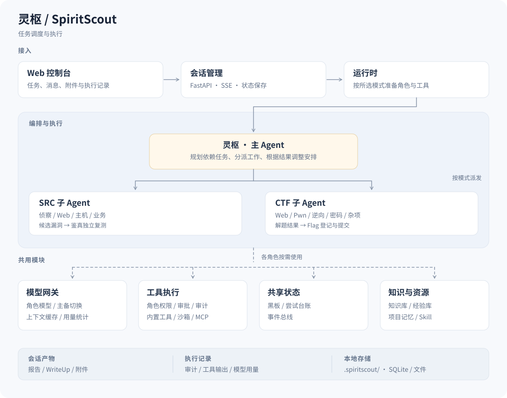

<div align="center">

# SpiritScout · 灵枢

**A multi-agent security testing workbench**

Assign a task in the browser. A lead agent plans it, specialist sub-agents execute in parallel,
and progress, evidence, and artifacts stay in the same session.

**English · [简体中文](README.md)**

[](CHANGELOG.md) [](pyproject.toml) [](https://github.com/FLIAZ/SpiritScout/actions/workflows/ci.yml) [](LICENSE)

[Quick start](#quick-start) · [Three modes](#three-modes) · [Interface](#interface) · [How it works](#how-it-works) · [Configuration](#configuration) · [FAQ](#faq) · [Deployment guide (中文)](docs/部署与配置.md)

</div>

> For authorized targets and competitions only. How scope is maintained, how approvals work, and where data lives: see [Data and boundaries](#data-and-boundaries) and the [security policy (中文)](SECURITY.md).

## What it is

A security testing workbench that runs on your machine or your own server. You describe the task in a web console — target, rules, attachments, mode — and SpiritScout (the lead agent) turns it into a dependency-aware task graph, hands the branches to specialist sub-agents, and lets you watch, steer, and review everything from one page.

Where it differs from "a chat box with a pile of tools":

| | What it means |
| --- | --- |
| **It plans** | The task is a DAG, not a stream of messages. You can see which branch is stuck and which challenge has not started |
| **It divides work** | Web, Pwn, reverse, crypto, and Misc each have their own sub-agent with its own tools and knowledge, sharing one blackboard of facts |
| **It cites sources** | Every conclusion traces back to the tool call and its raw output; the graph separates real output from context carry-over |
| **It asks, sometimes** | SRC dangerous operations require per-action approval; CTF and competition runs are pre-authorized but fully audited |

Models are not fixed: providers, model IDs, and per-role assignments are configured in the console and take effect immediately. Solution templates are not hardcoded — the knowledge base holds reference facts (platform behaviour, payloads, pitfalls), and the model decides the step sequence from what it sees.

Routing order is explicit assignment > session pick > the priority chain from the **Models** page. That chain is re-read while the service runs (every `gateway.priority_refresh_seconds`, 30 s by default), so reordering it affects sessions already in flight. Each session also has its own model picker in the session header: pick one and only that session switches over (lead agent plus sub-agents without an explicit assignment); per-role assignments in **Team** still win, and clearing the pick returns the session to the global chain.

## Three modes

| Mode | Typical use | Dangerous operations | Unattended | Asks you |
| --- | --- | --- | --- | --- |
| **SRC** | Authorized asset analysis, vulnerability reproduction, pentest reports | File deletion, reverse shells, WebShell upload, container escape, brute force — approved one by one | No | Yes: unclear scope or missing details |
| **CTF** | Web, Pwn, reverse, crypto, Misc challenges | Pre-authorized, fully audited | Yes | Yes, when a challenge is missing key details |
| **Agent competition** | Platform-hosted contests, multi-challenge scheduling, result collection | Pre-authorized, fully audited | Yes | No, and no public web search either |

The **user picks the mode** in the console; the backend never overrides it. The choice is remembered locally and becomes the default next time. Historical project assets never become the authorized target of a new run.

SRC refers to security response centre / bug bounty workflows.

## Interface

A single-page console. The sidebar keeps six primary sections (Tasks, Dashboard, Usage, Team, Projects, Experience); everything else lives under **Settings**:

| View | Purpose |
| --- | --- |
| **Tasks** | Pick a mode, fill in target, rules, attachments, launch the task; current session card |
| **Dashboard** | Cross-session calls, tokens, cost estimates, and alerts (model waits, idle slots with pending work, …) |
| **Usage** | Token spend by model: call count, input/output, cache reads, share and cost (last hour / today / 7 days / 30 days / all) |
| **Team** | Assign models and prompts to the lead agent and each sub-agent |
| **Projects** | Group assets and sessions; vulnerability candidates are independently reproduced by the verifier agent, Jianzhen |
| **Experience** | Reusable judgements and pitfalls learned from earlier runs; writes are de-duplicated (≥95% similar is treated as a repeat and dropped), and stored near-identical entries can be distilled (similarity defaults to 90% and is adjustable; you see the draft first and the originals are deleted only after you keep it) |

Session detail is not a nav entry — open it from the task list.

A task keeps running after you dispatch it; switching views does not pause it. **So when you navigate away, a bar floats up in the lower-left: "N tasks running in the background"** — expand it to see each task's title and state (queued / running), click a row to jump back, and it disappears on its own once everything settles. States only, no progress bar: the frontend does not know how far some other session has got, so rather than draw a fake one it lets you step in and look.

The **Settings** button at the bottom of the sidebar opens a full settings surface: a column of categories on the left, the matching content on the right. It is a page, not a modal, and switching back and forth with the main sections keeps your place; the entry reopens whichever category you last viewed.

| Settings category | Purpose |
| --- | --- |
| **Models** | Provider endpoints, API keys, model IDs, connectivity checks, enable / disable |
| **MCP** | MCP server config, management chat, Exa search |
| **Skill** | Skill packs and reference knowledge |
| **Notifications** | System notifications for solved challenges and questions waiting on you; switch, permission, read history |
| **Local tools** | Tool folders on this machine for the agent to search and run. Every run stages a copy with isolated TMP/HOME, then reconciles the original folder (new files deleted, changed files restored), verifies the manifest, and destroys the copy — no leftovers; oversized folders are refused |
| **About** | Version, theme, sign out |

The worst failure mode of a background task is a solved challenge nobody tells you about. **When a challenge is solved (the platform accepted the flag), or when the master agent is blocked on a question only you can answer, the console raises a system notification** — it reaches you even with the window in the background, and clicking it jumps straight back to that session. Without browser notification permission it degrades to an in-page toast plus a tab-title counter instead of going silent, and it stays quiet when you already have that session on screen. Polling rides the console's existing scheduler (15 s visible, 30 s hidden) rather than adding a timer, and "read" lives in the browser — so several tabs each keep their own screen.

Session tabs: **chat** · **graph** · **challenges** · **vulnerabilities** · **flags** · **experience** · **events** · **deliverables** · **write-up** · **report**.
The challenges tab exists in competition mode only; the write-up tab only appears in CTF mode: confirm team info and per-challenge chapters before generating. Everything can be left empty, and what you fill in is remembered.

## Capabilities

| Capability | What it provides |
| --- | --- |
| Agent teams | A lead agent decomposes tasks; sub-agents branch into approaches, share findings, and use models assigned by role |
| Execution workbench | Expand tasks, branches, and steps; inspect tool results and a process graph linked to audit records |
| Projects and artifacts | Persist assets and sessions; independently reproduce vulnerability candidates; generate reports or write-ups |
| CTF solution write-up | Draft a write-up in the organizer's template: confirm team info and chapters first (optional, remembered next time), chapters by direction, steps and flag capture per challenge, downloadable as Markdown |
| Browser and tools | Connect MCP servers, Skills, and shell/Python sandboxes; SRC can reuse authenticated sessions and let you handle CAPTCHAs |
| Models and usage | Configure providers, teams, and models; inspect estimated cost, tokens, and endpoint-reported input cache usage |
| Experience | Write verified judgements back into the experience store and reuse them in similar tasks |

----

Historical benchmark · tsecbench (2026-10-23)

Recorded with DeepSeek v4.1 Flash; kept for reference


## Quick start

### Docker (recommended)

Requires **Linux container mode** and **Docker Compose 2.20+**. Docker Desktop on Windows, Docker Engine on Linux; macOS / ARM64 compatibility is pending.

```bash
git clone https://github.com/FLIAZ/SpiritScout.git
cd SpiritScout
python deploy.py up
```

Use `py -3 deploy.py up` on Windows, `python3 deploy.py up` on Linux / macOS.
The first run creates `.env`, generates a random admin password, builds the image, and waits for health.

| Entry point | Address |
| --- | --- |
| **Console** | <http://127.0.0.1:10010> — credentials are in `.env` |
| **SRC browser** | After `python deploy.py up --browser`, open <http://127.0.0.1:10011>; same credentials |

| Command | Effect |
| --- | --- |
| `python deploy.py status` | Container status |
| `python deploy.py logs` | Follow logs |
| `python deploy.py down` | Stop, keeping data volumes |
| `python deploy.py doctor` | Self-check the deployment environment |
| `python deploy.py migrate` | Migrate a legacy bind-mount deployment to volumes |
| `python deploy.py up --no-build` | Restart from the existing image without rebuilding |
| `python deploy.py up --project-name other` | Isolate a second deployment (containers, volumes, network) |

The image ships Chromium and bubblewrap. Install the CTF toolkit on demand by setting `INSTALL_TOOLKIT=1` in `.env` and rebuilding.
Deployments use the image's own source with dedicated data volumes; to upgrade from a legacy bind-mount deployment, stop and migrate first — never delete the data volume.

<details>
<summary>Manual Docker Compose deployment</summary>

Copy `.env.example` to `.env`, set an admin username and a strong password, then start:

```bash
docker compose up -d --build --wait
```

Source overrides, admin recovery, reverse proxy, data migration and backups: see [deployment and configuration (中文)](docs/部署与配置.md).

</details>

### Local run on Linux / Windows

<details>
<summary>Expand local installation</summary>

Requires Python 3.11+. The native browser tool additionally needs Node.js 22+ and Chromium/Chrome, or point `SPIRITSCOUT_CHROME_EXECUTABLE` at an executable.

**Linux**

```bash
python3 -m venv .venv
.venv/bin/python -m pip install -e .
sudo apt install bubblewrap   # Debian / Ubuntu; Fedora: sudo dnf install bubblewrap
./launch.sh
```

**Windows (cmd)**

```bat
py -3 -m venv .venv
.venv\Scripts\python.exe -m pip install -e .
launch.cmd
```

Open <http://127.0.0.1:8000>, stop with `Ctrl+C`. Change the port with `./launch.sh --port 10010` or `launch.cmd --port 10010`.

The console prints the bind address first, then **waits until the port actually accepts
connections before saying `[就绪] 浏览器可以打开了`** — first boot creates databases and warms
up models, so a fixed delay would either lie or waste time. After that it reports a status
line every 60 seconds, so you do not need a task manager to know it is alive.

```
灵枢 Web 控制台 v0.44.0: http://127.0.0.1:8010  (管理员登录已启用，并发上限 4，Ctrl+C 停止)

[就绪] 浏览器可以打开了: http://127.0.0.1:8010
       每 60 秒报一次状态；Ctrl+C 停止

[状态] 已运行 01:00 · 会话 2（运行中 0） · 内存 244 MB
```
On first start the launcher asks you to set the admin password (typed twice, no echo) and
stores only its scrypt hash in `.spiritscout/admin.db`; press Enter twice to skip and stay
loopback-only. **Password length is not restricted** — one character or a whole sentence both
work — and the plaintext is shown **once**, in that terminal right after you set it; later
runs, logs and the UI never show it again (`--password-stdin` for automation does not echo it).
Change it later with `python -m spiritscout --set-admin-password`, or delete
`admin.db` to start over. Configure admin credentials and HTTPS before listening on any
external address.

The shell/Python sandbox needs Linux with bubblewrap. Native Windows and macOS consoles fall back to the host backend and lose that isolation; use Docker when you need the full toolchain. Never share virtual environments across Windows, WSL, and Linux.

</details>

### Run your first task

1. **Add a model**: open **Models**, fill in the provider endpoint, API key, and model ID, then test connectivity.
   Disable a model you are not using and it drops out of routing while keeping its config; re-enable it any time.
2. **Assign roles**: open **Team** and pick a model for the lead agent and each sub-agent (they may all be the same).
3. **Launch**: on **Home**, choose a mode, fill in target / challenges, rules, and attachments, then start the run.
4. **Watch**: open the session. The chat tab shows every step, the graph tab shows structure; answer or steer in the chat when needed.
5. **Collect**: the deliverables tab gives you the artifacts, the report and write-up tabs give you the documents, all downloadable as Markdown.

## How it works



```
user task ──► SpiritScout (lead agent)
                │  plan: task DAG (challenges / targets → parallel branches)
                ├──► sub-agent fleet (Web / Pwn / reverse / crypto / Misc …)
                │        └── tool layer: browser, shell/Python sandbox, MCP, Skills
                │        └── shared: blackboard (facts), attempt ledger (no repeat dead ends)
                └──► synthesis: flag judging, vulnerability verification, report / write-up
```

- **Planning continues during execution**: the lead agent sees branch progress and failures and re-plans; it is not a one-shot plan.
- **Facts live on one blackboard**: clues, findings, and topology land in the same place, so sub-agents do not rely on relaying through layers.
- **The attempt ledger prevents repeats**: repeatedly failing branches are recorded so the model changes approach instead of hitting the same wall.
- **Flags are judged by the model**: no backend regex extraction; submissions and the reasoning behind each verdict are kept.
- **The gateway centralises models**: provider protocols, streaming, usage, and cache accounting are handled in one layer.
- **The tool layer owns permissions**: approvals, sandboxing, and auditing are decided per mode; steps, observations, findings, and artifacts keep their original provenance.

Module layout and a function index: see the [architecture overview (中文)](docs/02-架构总览与项目结构.md) and the [code map (中文)](docs/10-代码地图与关键函数索引.md).

## Configuration

### Files

| File | Contents |
| --- | --- |
| `configs/system.yaml` | System settings: web listener, sandbox backend, event bus, paths (see `system.example.yaml`) |
| `configs/models.yaml` | Providers and models (see `models.example.yaml`) |
| `.env` | Admin credentials, image, and optional toolkit flags for Docker deployments |

Model configuration edited in the console overrides the startup snapshot; no restart needed.

### Environment variables

| Variable | Purpose |
| --- | --- |
| `SPIRITSCOUT_ADMIN_USERNAME` / `SPIRITSCOUT_ADMIN_PASSWORD` | Admin credentials imported into the admin store at startup (highest priority; overrides the locally set password and logs a warning) |
| `SPIRITSCOUT_SERVER_PASSWORD` | Legacy admin password, still supported; default username `spiritscout` |
| `SPIRITSCOUT_VAULT_KEY` | Master key for the credential vault; if unset, `vault.key` is generated on first start (mode 0600) |
| `SPIRITSCOUT_REMOTE_LLM_KEY` | Fallback source for the remote model key |
| `SPIRITSCOUT_SANDBOX_BACKEND` | `auto` (default) / `bwrap` / `host`. auto uses bwrap when present, host on Windows/macOS |
| `SPIRITSCOUT_HOST_BASH` | Shell used by the host backend (e.g. Git Bash on Windows) |
| `SPIRITSCOUT_CHROME_EXECUTABLE` | Explicit Chromium/Chrome executable |
| `SPIRITSCOUT_CHROME_CDP_URL` | CDP endpoint of an existing browser |
| `SPIRITSCOUT_CHROME_MODE` | `cdp` (default) or `headless` |
| `SPIRITSCOUT_BROWSER_TMP_PRUNE_MB` | Browser temp-profile prune threshold, default 64; `0` prunes on every exit |
| `SPIRITSCOUT_BUS__BACKEND` | Event bus backend, e.g. `redis` |
| `SPIRITSCOUT_REDIS_URL` | Redis connection string |

Any configuration key can be overridden with `SPIRITSCOUT_<section>__<field>`, for example
`SPIRITSCOUT_WEB__PORT=10010` is equivalent to editing `web.port` in `system.yaml`.

### Where data lives

Native runs use `.spiritscout/`; Docker uses the config volume, the data volume, and an optional browser profile volume.

| Path | Contents |
| --- | --- |
| `sessions/` | Per-session workspace: blackboard, audit, flags, reports, write-ups, screenshots |
| `resources/` | Knowledge and resource stores |
| `admin.db` | Admins and login sessions |
| `vault.db` / `vault.key` | Encrypted provider keys and the master key |
| `usage.db` | Call and token accounting |
| `experience.db` | Experience store |
Every distill path — automatic, manual, resume-after-restart, the experience page and start-up recall — resolves the store through one function (`shared_db_path(cfg)`), so `experience.db` is a single ledger under the workspace root rather than one file per session. Before an insight is stored it is compared with the most recent 2,000 live entries; anything at or above `experience.duplicate_threshold` (default **95%** normalised edit similarity) is cancelled instead of stored, and the distill result reports how many were skipped as `duplicates`.

| `audit.jsonl` | Global audit trail |
| `preferences.json` | UI preferences (currently the last selected mode) |
| `wp-profile.json` | Team info used by write-ups (created after first use) |

Back up the whole `.spiritscout/` directory together with `.env`. Backing up the databases without `vault.key` leaves the stored keys undecryptable.

### Command line

```bash
spiritscout --version            # version
spiritscout --host 0.0.0.0 --port 8000
spiritscout --config path/to/system.yaml
```

## FAQ

**Connectivity passes but the task fails immediately?**
The connectivity test only asks the model to reply `ok`; it does not exercise a full streaming tool request. Compatible LiteLLM / MCP versions are pinned — rebuild the image after dependency changes instead of upgrading LiteLLM alone. See [model calls and dependency compatibility (中文)](docs/部署与配置.md#模型调用与依赖兼容).

**Nothing runs on Windows?**
The shell/Python sandbox needs Linux with bubblewrap. A native Windows console falls back to the host backend with reduced tooling. Use Docker Desktop for the full toolchain, or install Git Bash and point `SPIRITSCOUT_HOST_BASH` at it.

**Port already in use?**
Change the port mapping in `.env` for Docker, or pass `--port` for local runs, then use the new address.

**How do I switch models?**
Add the provider and model ID in **Models**, then reassign roles in **Team**. No config edits and no restart.

**Why is the write-up team info empty?**
The info form can be left completely empty — blank fields render as "to be filled in" and never block generation. Once filled, it is remembered; clearing it forgets it. Per-challenge chapters are not persisted: if challenge IDs change, directions are re-derived from the challenge text.

**A session looks stuck.**
Check the dashboard alerts first — long model waits and idle capacity with pending work are reported separately. Then look at the last tool result in the chat tab and steer from the chat if needed.

**How do I migrate data?**
Use `python deploy.py migrate` for Docker. Manually: stop the service, copy `.spiritscout/` (or the data volume), start on the new host. Keep `vault.key` and `admin.db`, otherwise credentials and logins are lost.

## Data and boundaries

- **Scope** is maintained by the model from your wording, project rules, and follow-up answers. The backend keeps no hardcoded block list; widening scope requires asking you.
- **Approvals**: SRC dangerous operations ask every time; CTF and competition runs are pre-authorized and audited. The sandbox is hardening, not a deterministic boundary on target scope.
- **Credentials**: API keys are encrypted in the workspace. Never publish real cookies, HAR files, or raw audit logs.
- **Cost**: model and paid search fees are billed by the services you connect. Dashboard figures are estimates; the provider invoice is authoritative.
- **Cache and baselines**: cache hit counts come from endpoint responses; failures, cancellations, and unknown usage are recorded separately. See [cache optimisation and testing (中文)](docs/05-核心算法与技术实现.md#稳定前缀与测试修复0122).

## Docs and contributing

Current code version: **v0.44.0**. The single source of the version, the bump rules, and the history: see [version management (中文)](CONTRIBUTING.md#版本管理).

| I want to | Read |
| --- | --- |
| Install, configure models and browsers, migrate, back up | [Deployment and configuration (中文)](docs/部署与配置.md) |
| Understand the architecture and code layout | [Documentation index (中文)](docs/README.md) |
| Understand the core algorithms | [Core algorithms and implementation (中文)](docs/05-核心算法与技术实现.md) |
| Fix a bug or add a feature | [Contributing (中文)](CONTRIBUTING.md) · [Agent conventions (中文)](AGENTS.md) |
| Track version changes | [Changelog](CHANGELOG.md) |
| Report a vulnerability privately | [Security policy (中文)](SECURITY.md) |

## License and usage terms

Project code is licensed under the [Apache License 2.0](LICENSE). Bundled knowledge bases, Skills, and external tools keep their own licenses.

<details>
<summary>Legal disclaimer and compliance notice (中文原文)</summary>

### 1. 工具定位

本项目（以下简称「本工具」）为网络安全学术研究、授权安全测试、企业内部风险自查用途的开源技术工具。

本工具所有功能仅面向拥有合法授权的测试场景，旨在提升网络安全防御能力、助力漏洞合规治理、推进安全技术学术研究。

### 2. 严格授权使用原则

所有使用者必须提前获得目标系统的书面合法授权。

严禁在无授权、越权、超范围情况下，对以下对象进行扫描、探测、渗透、数据获取、流量分析、自动化测试：

- 互联网公网任意未授权系统
- 金融、能源、政务、运营商、交通等关键信息基础设施
- 第三方企业、个人、公有云任意业务系统
- 任何法律法规禁止测试的信息系统

未授权测试即属于违法行为，使用者自行承担全部法律责任。

### 3. 禁止滥用条款

所有使用者承诺：

1. 不得利用本工具实施非法入侵、非法控制、数据窃取、流量攻击、漏洞滥用等违法犯罪行为；
2. 不得将本工具用于黑产、牟利、恶意破坏、未授权批量扫描、网络骚扰等场景；
3. 不得绕过、破解本工具内置的安全限制、黑白名单风控机制用于非法用途；
4. 不得用于危害国家网络安全、扰乱公共秩序、侵犯他人合法权益的活动。

### 4. 责任边界（核心免责）

1. 项目开源作者、维护团队、贡献者：仅提供公开的技术代码与学术实现，不参与、不知情、不协助任何第三方的非法使用行为，不对第三方滥用产生的任何后果承担刑事、行政、民事连带责任。
2. 本工具技术中立，合法合规用途明确，任何使用者的违法操作均为独立个人行为，与项目作者无关。

### 5. 强制合规义务

使用者使用本工具即默认表示：

- 已充分知晓《中华人民共和国网络安全法》
- 已充分知晓《中华人民共和国刑法》第285条、第286条相关规定
- 已具备合法网络安全测试资质或授权资质
- 自愿承担所有使用风险及法律后果

### 6. 违规处置机制

项目团队保留以下权利：

- 随时关停仓库、终止分发、更新风控限制
- 举报、记录、留存恶意滥用行为证据
- 拒绝为非法使用者提供任何技术答疑、指导、更新、协助

### 7. 最终声明

本工具严禁非法滥用。任何违法使用行为，由行为人独立承担全部法律责任，与项目开发、维护、贡献团队无关。

</details>

## Acknowledgements

<details>
<summary>Knowledge bases, reference projects, MCP servers, skill sources, and users</summary>

### Knowledge base sources

- [PayloadsAllTheThings](https://github.com/swisskyrepo/PayloadsAllTheThings)（MIT）
- [NoorQureshi/security-skills](https://github.com/NoorQureshi/security-skills)（MIT）

### Reference projects

- [carlospolop/HackTricks](https://github.com/carlospolop/HackTricks)（CC BY-NC-SA）
- [OWASP WSTG](https://github.com/OWASP/wstg)（CC BY-SA-4.0）
- [GTFOBins](https://github.com/GTFOBins/GTFOBins.github.io)（GPL-3.0）
- [VoltAgent/awesome-agent-skills](https://github.com/VoltAgent/awesome-agent-skills)（MIT）

### MCP servers used by the project

Whether each server is enabled depends on your local configuration:

| MCP | License | Purpose |
| --- | --- | --- |
| [ida-pro-mcp](https://github.com/mrexodia/ida-pro-mcp) | Custom | Reverse engineering: decompilation / xrefs / function and type lookup (headless idalib) |
| [yakit](https://github.com/yaklang/yakit) | Custom | Web pentesting: encoding / HTTP traffic / fuzzing / fingerprinting / ports / deserialization |
| [playwright-mcp](https://github.com/microsoft/playwright-mcp) | Apache-2.0 | Browser automation: JS-rendered DOM / clicks / forms / screenshots |
| pentester-mcp | Custom | Pentest toolkit: nmap / nuclei / sqlmap / ffuf / impacket / hydra |
| burp-mcp | Custom | Web vulnerability scanning and fuzzing (official PortSwigger extension) |
| shodan-mcp | MIT | Asset intelligence (outbound to a third-party service) |
| virustotal-mcp | MIT | File / domain intelligence (VirusTotal hosted endpoints) |

### Skill sources

- [obra/superpowers](https://github.com/obra/superpowers)
- [anthropics/skills](https://github.com/anthropics/skills)
- [VoltAgent/awesome-agent-skills](https://github.com/VoltAgent/awesome-agent-skills)

### Users

- [@BProbie](https://github.com/BProbie)：documentation formatting fixes
- [@k1ne](https://github.com/k1ne7)：multi-platform compatibility
- [@neko](https://github.com/neko-11451)：login page front-end polish

</details>

## Star History

<a href="https://www.star-history.com/?repos=fliaz%2Fspiritscout&type=date&legend=top-left">
 <picture>
   <source media="(prefers-color-scheme: dark)" srcset="https://api.star-history.com/chart?repos=fliaz/spiritscout&type=date&theme=dark&legend=top-left" />
   <source media="(prefers-color-scheme: light)" srcset="https://api.star-history.com/chart?repos=fliaz/spiritscout&type=date&theme=light&legend=top-left" />
   
 </picture>
</a>
